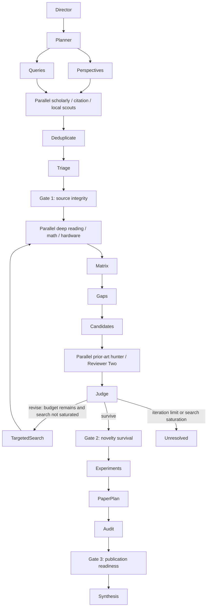

# Workflow and recovery

An unsuccessful gate is persisted with reasons. A run may finish a limited report while
publication readiness remains false. No failed gate is bypassed by changing wording.
Each revision searches again, reads new evidence, rebuilds matrix/gaps and revises
candidates before another independent attack. Rejected and unresolved candidates remain visible.

QUICK uses planning and grounded synthesis. REVIEW adds discovery, reading and audit.
DEEP adds math/hardware, matrix, gaps and experiment planning. NOVELTY runs the full graph.
AUDIT runs discovery/reading plus adversarial review and citation audit, requiring an explicit
claim or producing an incomplete audit. Mode budgets bound the graph; an LLM never owns it.

Stages write checkpoints after completion. Resume replays only incomplete stages; completed
stages are idempotent through deterministic artifact identity and transactions. Failed scouts
record errors while successful branches continue. All scouts failing yields a limited report.
Concurrent ownership is prevented by a run lease; abrupt process termination is recoverable
after lease expiry. Config and workflow versions are pinned per run.
TargetedSearchRequest records retain candidate revision, queries, reasons and completion state.
Resume rechecks cached novelty survival rather than trusting a prior gate boolean.
Located chunking and lexical ranking select the reading window before extraction; failed
scouts remain explicit, and only completed low-information rounds can establish saturation.

Optional human approval pauses after plan, before DEEP, after gaps, before accepting novelty,
and before final report. Approval/rejection/modification is recorded; continue cannot bypass a
pending approval. Rejected work halts. Modified inputs invalidate dependent stages.
